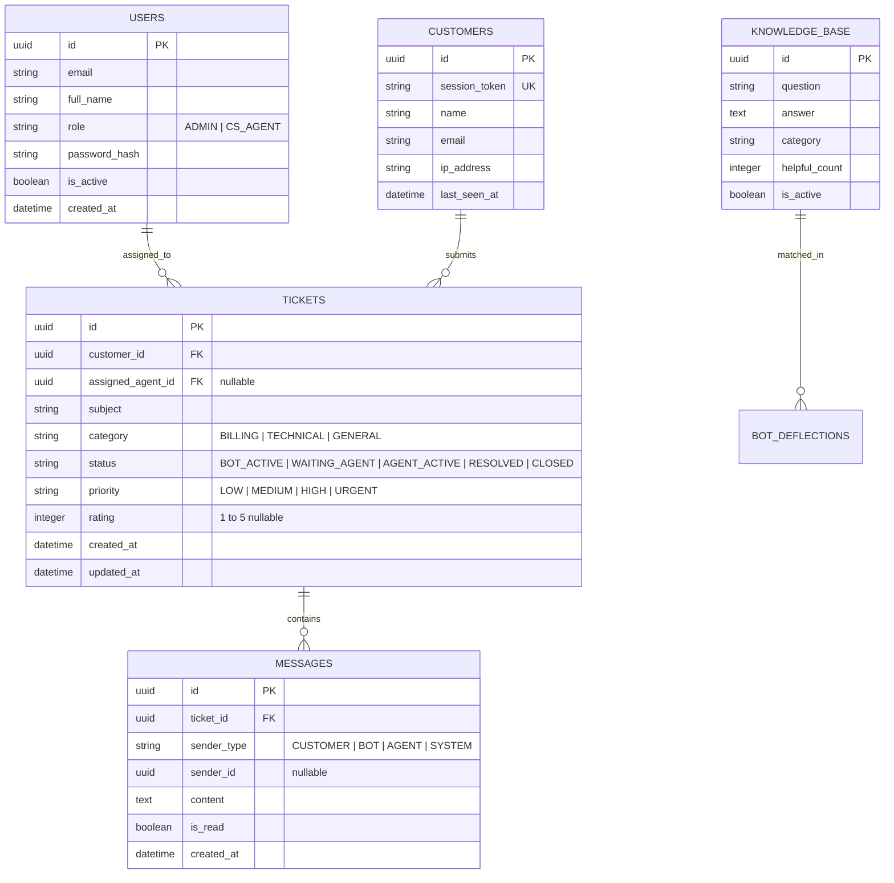

# Architecture & System Design Document
## Multi-Platform Helpdesk & Live Support System

**Target Proyek:** CIHEUL TECHNOLOGIES - Take Home Programming Test  
**Pola Repository:** Monorepo (Single Git Repository)

---

## 1. Struktur Monorepo Direktori

```text
ciheul-helpdesk/
├── backend/                  # Python FastAPI Backend & WebSocket Hub
│   ├── app/
│   │   ├── api/              # REST Endpoints (auth, tickets, kb, analytics)
│   │   ├── core/             # Config, security, database session
│   │   ├── models/           # SQLAlchemy Data Models
│   │   ├── schemas/          # Pydantic Request/Response DTOs
│   │   ├── services/         # Business Logic, AI Bot Engine, Ticket Service
│   │   └── websockets/       # ConnectionManager, Room Dispatcher, Heartbeat
│   ├── tests/                # Pytest Unit & Integration Tests
│   ├── requirements.txt      # Python Dependencies
│   └── main.py               # ASGI Application Entrypoint
│
├── web-dashboard/            # CS & Admin Dashboard (HTML5 + Tailwind CSS + Modular JS)
│   ├── index.html            # CS Workspace & Live Ticket Kanban
│   ├── assets/               # Icons, Styles, Sound Notifications
│   └── js/                   # WebSocket Client, Ticket State, UI Controllers
│
├── widget-js/                # Embeddable Live Chat Widget (Vanilla JavaScript)
│   ├── dist/
│   │   ├── widget.js         # Single-file bundled embed script (< 40 KB)
│   │   └── widget.css        # Encapsulated styles (scoped namespace `.ch-widget-*`)
│   └── demo.html             # Standalone simulation page embedding the widget
│
├── mobile-flutter/           # Cross-Platform CS Mobile App (Flutter)
│   ├── lib/
│   │   ├── core/             # WebSocket Service, Storage, Constants, Theme
│   │   ├── models/           # Ticket & Message Models
│   │   ├── providers/        # State Management (Ticket & Chat Riverpod/Provider)
│   │   ├── views/            # Ticket List Screen, Chat Room Screen, Settings
│   │   └── main.dart         # Flutter Application Entrypoint
│   ├── pubspec.yaml          # Flutter Dependencies
│   └── android/              # Android Gradle Configuration
│
├── docs/                     # Submission Deliverables & Analysis
│   ├── bpmn/                 # Swimlane BPMN (.drawio & exported PDF)
│   └── wbs/                  # Work Breakdown Structure (.xlsx spreadsheet)
│
├── .github/
│   └── workflows/
│       └── build-apk.yml     # Automated CI/CD Workflow to Compile Flutter Release APK
│
├── prd.md                    # Product Requirement Document
├── AGENTS.md                 # Agent Guidelines & Anti-Slop Rules
├── Architecture.md           # System Architecture & Design (This File)
├── skill.md                  # Project Engineering Skills
└── workflow.md               # 10-Step Implementation Roadmap
```

---

## 2. Technology Stack & Rationale

| Komponen | Teknologi | Alasan Pemilihan |
| :--- | :--- | :--- |
| **Backend API & WebSockets** | **Python (FastAPI + Uvicorn)** | Performa asinkronus (ASGI) tinggi, native WebSocket support, integrasi AI/ML Python ekosistem yang mulus, auto-generated OpenAPI docs. |
| **Database & ORM** | **SQLite (Dev) / PostgreSQL (Prod) via SQLAlchemy** | Memenuhi syarat soal (*sqlite/PostgreSQL*), transaksional aman, mudah dijalankan secara lokal tanpa dependensi rumit. |
| **Chat Widget** | **Vanilla JavaScript (ES6+)** | Memenuhi kewajiban soal (*Wajib menggunakan Javascript*), bebas bloatware framework, ringan, cepat dimuat di halaman web manapun. |
| **CS Web Dashboard** | **HTML5 + Modern Tailwind CSS (Dark Mode)** | Tampilan modern bernuansa *Slate/Obsidian*, responsif, tanpa *AI-slop*, mudah diinspeksi reviewer. |
| **CS Mobile App** | **Flutter (Dart)** | Memenuhi kewajiban soal (*Wajib menggunakan Flutter*), single codebase untuk Android & iOS, performa 60 FPS. |
| **CI/CD Build** | **GitHub Actions** | Memastikan APK release ter-compile secara otomatis di cloud tanpa membebani laptop kandidat. |

---

## 3. Database Schema (Entity-Relationship Diagram)

Sistem menggunakan 5 entitas relasional utama:



---

## 4. Real-time WebSocket Protocol & Event Schema

Semua pesan yang dialirkan melalui WebSocket menggunakan format JSON terstandarisasi:

```json
{
  "event": "EVENT_NAME",
  "ticket_id": "c1f7b820-...",
  "sender_type": "CUSTOMER | BOT | AGENT | SYSTEM",
  "payload": {},
  "timestamp": "2026-10-22T08:00:00Z"
}
```

### Event Catalog:
1. `join_session`: Client mendaftarkan diri ke room tiket tertentu (`ticket_id`).
2. `send_message`: Mengirimkan pesan baru dari customer atau CS.
3. `new_message`: Broadcast pesan baru ke semua pihak dalam room.
4. `ticket_escalated`: Sinyal eskalasi dari bot ke CS (membunyikan notifikasi di Web & Mobile CS).
5. `claim_ticket`: Agen CS mengklaim tiket; bot dinonaktifkan secara otomatis.
6. `typing_indicator`: Sinyal indikator pengetikan (*Customer is typing...*).
7. `ping` / `pong`: Heartbeat periodik setiap 15 detik untuk menjaga koneksi tetap hidup.

---

## 5. Mekanisme "Always-Connected" & Offline Recovery

Untuk memenuhi syarat soal: *"Komunikasi antara Live Chat Widget terhadap Web App dan Mobile App harus selalu terkoneksi dalam kondisi apapun"*:

1. **Heartbeat Protocol:**
   - Client mengirimkan paket `ping` setiap 15 detik. Jika server tidak membalas `pong` dalam 5 detik, koneksi dianggap terputus (*stale*).
2. **Auto-Reconnect with Exponential Backoff:**
   - Jika koneksi terputus (misal ganti koneksi Wi-Fi/kuota atau laptop *sleep*), client langsung mencoba koneksi ulang dengan interval: $1s \rightarrow 2s \rightarrow 5s \rightarrow 10s$.
3. **Missed Messages Catch-up:**
   - Setiap kali *reconnect* berhasil, client mengirimkan parameter `last_received_message_id`. Backend memeriksa apakah ada pesan yang masuk saat client offline dan mengirimkannya seketika (*replay missed messages*).

---

## 6. AI Bot Deflection & Human Escalation Architecture

```
[Pesan Masuk dari Pelanggan]
            │
            ▼
    [Apakah Tiket Masih Status 'BOT_ACTIVE'?]
        ├── TIDAK (Sudah dipegang CS) ──► Langsung route ke CS
        │
        └── YA (Masih dalam kendali AI)
                │
                ▼
        [1. Intent & FAQ Matching Engine]
        - Mencocokkan query dengan tabel KNOWLEDGE_BASE.
        - Menghitung Confidence Score (0.0 - 1.0).
                │
        ├── Score >= 0.75 ──► Kirim Jawaban AI + Opsi "Bicara CS"
        │
        └── Score < 0.75 ATAU User Minta CS ("mau bicara manusia")
                │
                ▼
        [2. Trigger Escalation]
        - Ubah status tiket: 'WAITING_AGENT'.
        - Simpan pesan sistem: "Menghubungkan Anda ke Customer Support...".
        - Broadcast event `ticket_escalated` via WebSocket ke Web Dashboard & Flutter App.
```

---

## 7. Pipeline Otomasi Build APK (GitHub Actions)

Karena kandidat wajib menyertakan file APK, workflow `.github/workflows/build-apk.yml` akan secara otomatis:
1. Menjalankan checkout repository.
2. Memasang Java JDK 17 dan Flutter SDK versi stabil.
3. Menjalankan `flutter pub get`.
4. Menjalankan `flutter build apk --release --split-per-abi` atau fat APK universal.
5. Mengunggah file `.apk` ke tab **GitHub Releases / Action Artifacts**, sehingga penguji atau kandidat tinggal mengklik link unduhan.
