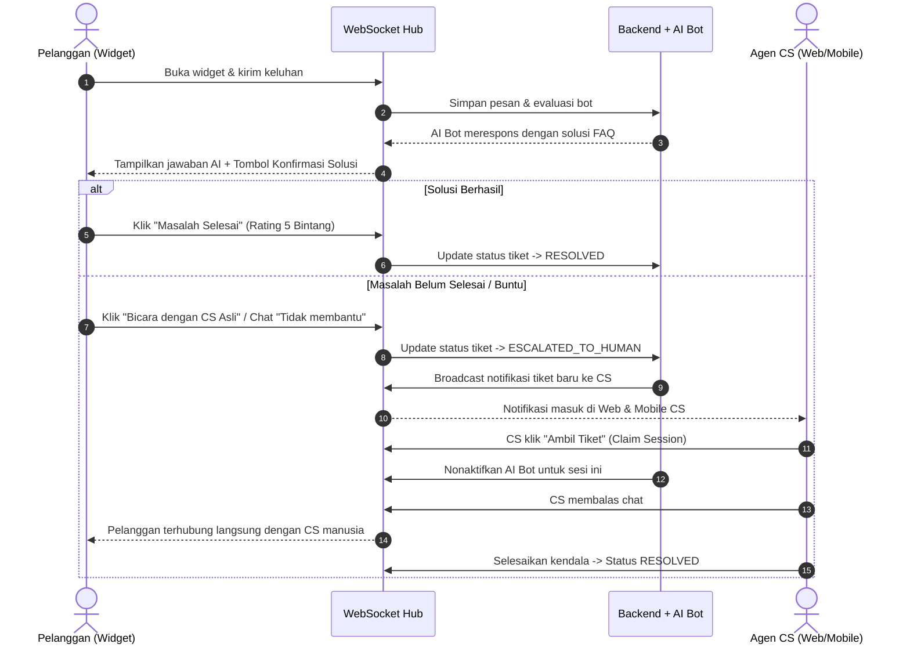

# Product Requirement Document (PRD)
## Multi-Platform Helpdesk & Live Support System

**Target Proyek:** Take Home Programming Test Software Engineer - CIHEUL TECHNOLOGIES  
**Aplikasi:** Opsi 1 - Aplikasi Helpdesk (Omnichannel Live Support & Ticket Tracking)  
**Status:** DRAFT / APPROVED FOR PLANNING  
**Repository Pattern:** Monorepo (Single Repository)

---

## 1. Executive Summary & Tujuan

Aplikasi Helpdesk ini dibangun untuk menyelesaikan masalah pelacakan kendala pelanggan (*issue tracking*) secara *real-time* dan *omnichannel*. Sistem memungkinkan pelanggan melaporkan kendala melalui **Live Chat Widget** yang ringan di web, ditangani secara otomatis oleh **AI Bot Assistant**, dan dievaluasi/dieskalasi secara instan kepada **Customer Support (CS)** baik melalui **Web App Dashboard** maupun **Mobile App (Flutter)**.

### Kriteria Keberhasilan (Success Criteria):
1. **Always-Connected Realtime Sync:** Komunikasi antara Live Chat Widget, Web Dashboard CS, dan Mobile App CS selalu terhubung (*bidirectional WebSocket*) dengan mekanisme *auto-reconnect* dan *offline message recovery*.
2. **AI-to-Human Escalation (Handoff):** AI Bot mampu menjawab kendala umum secara otomatis dari *Knowledge Base*; jika pelanggan buntu/tidak puas, sesi percakapan secara mulus dieskalasi ke antrean CS manusia.
3. **Clean Architecture & High Maintainability:** Kode terstruktur modular (FastAPI backend, Vanilla JS Widget terisolasi, Flutter clean architecture, SQLite/PostgreSQL schema relational yang ternormalisasi).
4. **Deliverable Lengkap:** Source code monorepo, file APK Android Flutter (via GitHub Actions CI build), dokumen BPMN Swimlane (.drawio & PDF), dan file Excel WBS (.xlsx).

---

## 2. Aktor & User Roles

| Role | Platform Utama | Tanggung Jawab & Hak Akses |
| :--- | :--- | :--- |
| **Pelanggan (Customer / End-User)** | Live Chat Widget (Web Browser) | Memulai sesi konsultasi, mengirim pesan keluhan, menerima respons instan dari AI Bot, meminta eskalasi ke CS manusia, memberikan rating kepuasan. |
| **Customer Support (CS Agent)** | Web App Dashboard & Mobile App (Flutter) | Menerima notifikasi tiket eskalasi baru, mengklaim tiket (*claim session*), membalas percakapan pelanggan secara real-time, memperbarui status tiket (`OPEN`, `IN_PROGRESS`, `RESOLVED`, `CLOSED`), menambahkan internal notes. |
| **Supervisor / Admin** | Web App Dashboard | Memantau seluruh percakapan aktif, melihat SLA & waktu respons CS, mengelola akun CS, mengelola *Knowledge Base / FAQ* untuk AI Bot, melihat metrik analitik kendala. |
| **AI Bot Assistant** | Backend Service (Automated Agent) | Menjawab keluhan pengguna pertama kali, melakukan klasifikasi kategori masalah, menghitung *confidence score*, dan memicu *handoff trigger* ke CS manusia saat buntu. |

---

## 3. Fitur Utama & Kebutuhan Fungsional

### 3.1 Live Chat Widget (Floating JavaScript)
- **Floating Launcher:** Tombol melayang di pojok kanan bawah halaman web dengan ikon yang jelas dan status CS (*Online / Offline*).
- **Embedded Modal Container:** Antarmuka chat responsif, cepat dimuat, tidak merusak styling host website.
- **Realtime Chat Feed:** Pengiriman dan penerimaan pesan instan via WebSocket, indikator pesan terkirim/dibaca (*delivery receipt*), dan *typing indicator*.
- **Handoff Action Button:** Opsi cepat bagi user untuk menekan tombol "Hubungi CS Manusia" jika solusi bot belum menyelesaikan masalah.

### 3.2 Backend Service & API (Python - FastAPI)
- **RESTful API:** Manajemen user, autentikasi CS (JWT), riwayat tiket, kategori masalah, manajemen knowledge base.
- **WebSocket Gateway:** Hub perutean pesan real-time 3-arah (*Customer Widget* $\leftrightarrow$ *Web Dashboard* $\leftrightarrow$ *Mobile Flutter*).
- **Connection Registry & Session State Manager:** Mengelola status koneksi soket, deteksi *heartbeat (ping-pong)*, dan sinkronisasi pesan tertinggal (*missed message catch-up*).
- **AI Triage & Auto-Reply Engine:** Integrasi model AI (Gemini / OpenAI compatible API) yang mencocokkan keluhan dengan knowledge base dan mengekstrak *intent* serta *sentiment*.

### 3.3 Web App Dashboard (CS & Admin)
- **Tampilan Antarmuka Modern:** Dark Mode elegan berbasis Obsidian/Slate Palette, kontras tinggi, bebas *AI-slop* (tidak menggunakan titik hijau berkedip).
- **Live Ticket Kanban / List:** Daftar antrean tiket real-time dengan status badge jelas (`BOT_HANDLING`, `WAITING_AGENT`, `ACTIVE`, `RESOLVED`).
- **Interactive Chat Room:** Komponen chat real-time, panel info pelanggan, riwayat pesan sebelumnya, dan tombol ganti status tiket.
- **Knowledge Base Management:** Form CRUD artikel bantuan untuk panduan AI Bot.

### 3.4 Mobile App (Flutter Android/iOS)
- **Cross-Platform CS Client:** Aplikasi khusus agen CS untuk melayani chat di mana saja.
- **Realtime WebSocket Client:** Background sync, auto-reconnect saat perpindahan koneksi jaringan.
- **In-App / Push Notification Simulation:** Notifikasi visual dan audio saat ada eskalasi tiket baru dari pelanggan.
- **Quick Reply & Ticket Resolution:** Template pesan cepat dan aksi resolusi tiket langsung dari ponsel.

---

## 4. User Flow & Skenario Bisnis

### Alur Utama: Pelanggan $\rightarrow$ AI Bot $\rightarrow$ CS Manusia

---

## 5. Kebutuhan Non-Fungsional (NFR)

1. **Keandalan Koneksi (Reliability):**
   - Toleransi putus jaringan: Client (Widget & Flutter) melakukan *exponential backoff retry* (1s, 2s, 5s, 10s).
   - *Message Integrity:* Setiap pesan memiliki UUID unik; backend mendeteksi duplikasi pesan.
2. **Keamanan (Security):**
   - Bebas SQL Injection: Menggunakan ORM (SQLAlchemy / SQLModel) dengan *parameterized queries*.
   - Proteksi XSS pada Chat Widget: Sanitasi input HTML/script sebelum di-render di DOM.
   - Autentikasi CS: Password di-hash menggunakan `bcrypt` / `argon2`, sesi dilindungi JWT Bearer Token.
3. **Performa (Performance):**
   - Latensi transmisi pesan WebSocket sub-100ms pada jaringan lokal.
   - Ukuran bundle JavaScript Widget $< 50$ KB (tanpa framework berat, murni Vanilla JS).
4. **Build & Release Automation:**
   - GitHub Actions workflow untuk otomatis meng-compile APK Flutter release pada setiap push ke branch `main`.
